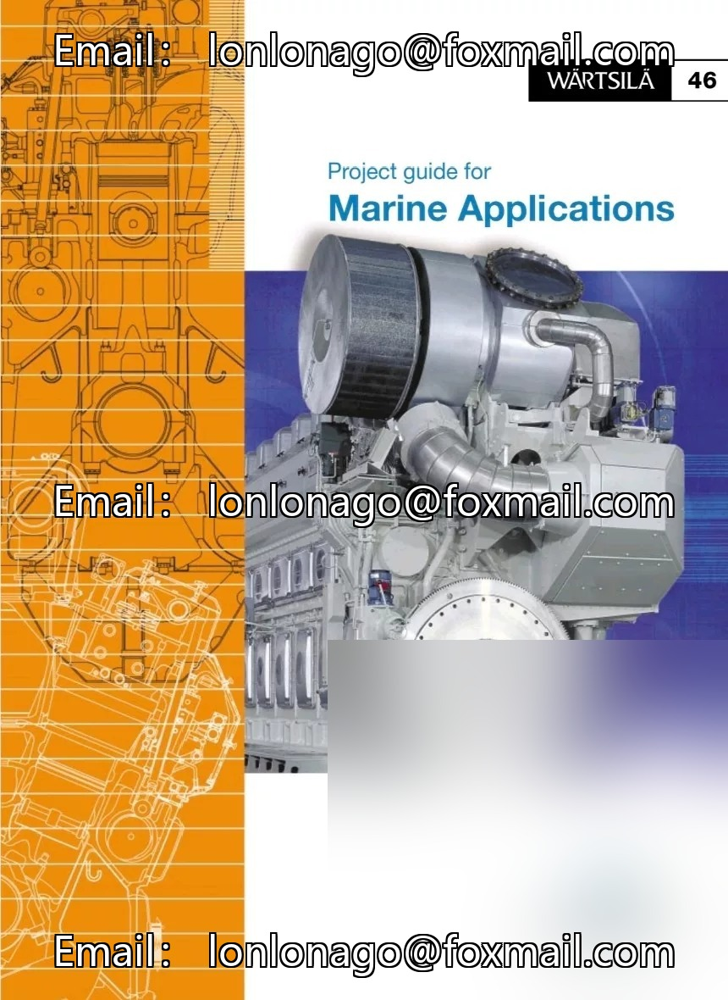
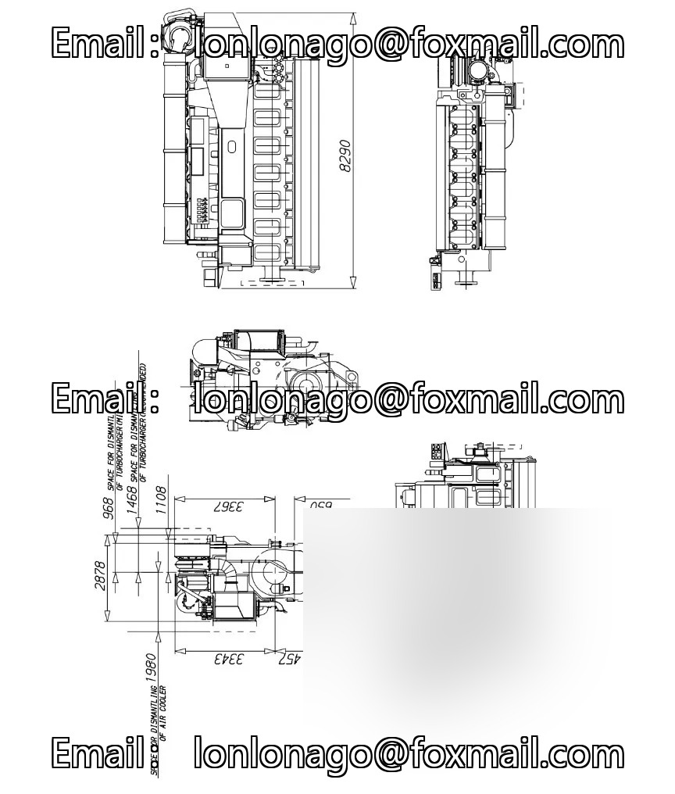
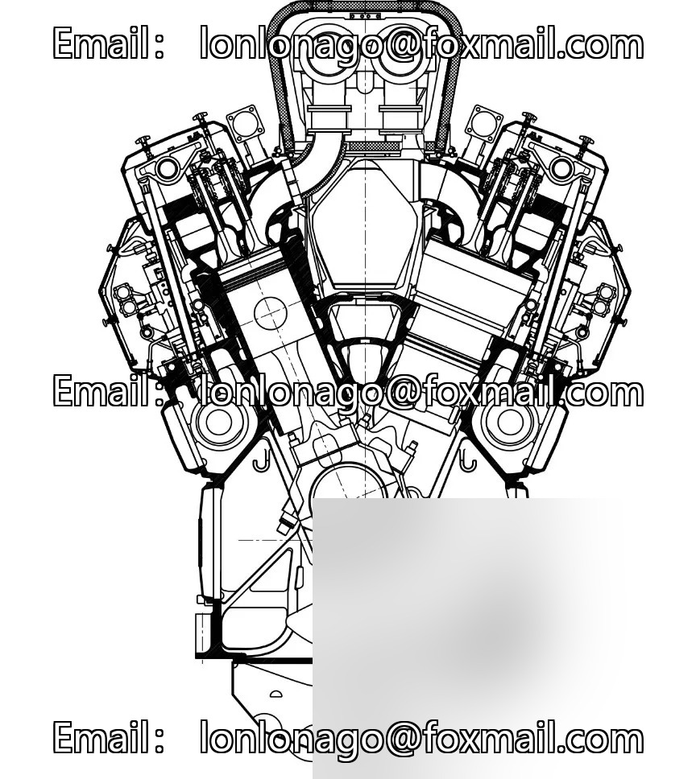
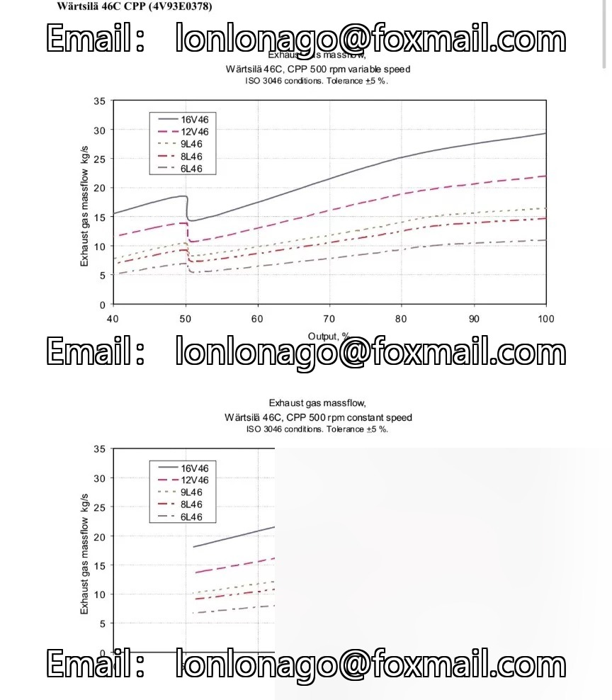
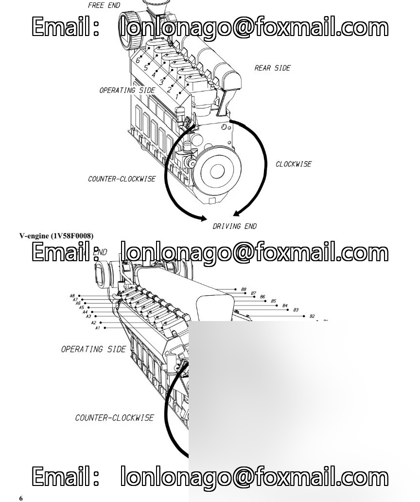

# "Valtray 46 series marine engine application project guide" (Project)

## Body

"The WSIAN 46 Series Marine Engine Application Project Guide" (Project Guide for Marine Applications).
PDF file, 210 pages.
The content of the materials covers the design, parameters, applications, and project implementation guidance of the WSIAN 46 series engine, suitable for research and reference on ship engineering, power systems, and technology.
sold without refund.

The material covers the design, parameters, applications and project implementation guidance for Wartsala 46 marine engines, delivered as a PDF of 210 pages.

<!-- AI_ENRICHED -->

## Images

## Payment

Here is a pay link on Stripe ( https://buy.stripe.com/3cs8yP7sY87d0vu9AB ). Please contact me lonlonago@foxmail.com after funding $89, and I will send you a complete data files , thank you!

